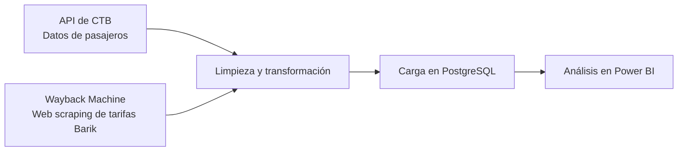

# Proyecto end-to-end de transporte en Bizkaia

Proyecto de extracción, transformación y carga de datos de transporte de Bizkaia, con almacenamiento en PostgreSQL y análisis mediante un dashboard de Power BI.

## Flujo del proyecto

1. **Extracción de pasajeros:** obtiene datos de la API configurada para CTB.
2. **Extracción de tarifas:** realiza web scraping de páginas históricas de tarifas Barik archivadas en [Internet Archive Wayback Machine](https://web.archive.org/).
3. **Limpieza:** prepara y transforma los datos extraídos.
4. **Carga:** almacena la información en PostgreSQL.
5. **Análisis:** presenta los datos mediante el informe de Power BI.

Los pasos están organizados en los módulos de `src/`: `extraccion.py`, `limpieza.py`, `carga.py` y `orquestador.py`.

## Fuentes de datos

- **Datos de pasajeros:** API de CTB, configurada mediante la variable `URL`.
- **Tarifas Barik:** páginas históricas de CTB recuperadas desde Wayback Machine mediante web scraping.

El acceso a las páginas archivadas depende de su disponibilidad en Wayback Machine y de las condiciones de uso de las fuentes.

## Tecnologías

- Python 3.14
- pandas y NumPy
- requests
- PostgreSQL y psycopg
- Power BI

## Estructura

- `src/`: módulos del proceso ETL.
- `sql/schema.sql`: creación y comprobación de tablas.
- `powerbi/`: informe y modelo semántico de Power BI.
- `PBI.html`: página que muestra el informe incrustado.
- `output/`: carpeta destinada a resultados generados.
- `tests/`: carpeta destinada a pruebas automatizadas.
- `requirements.txt`: dependencias del proyecto.
- `.env.example`: plantilla de configuración.

## Requisitos

- Python 3.14
- Una instancia de PostgreSQL accesible
- Acceso a la API de datos de transporte
- Power BI, si se quiere abrir o editar el informe

## Instalación

En PowerShell, desde la carpeta raíz del proyecto:

1. Crea y activa un entorno virtual:

   `py -3.14 -m venv .venv`

   `.\.venv\Scripts\Activate.ps1`

2. Instala las dependencias:

   `python -m pip install -r requirements.txt`

## Configuración

Crea un archivo `.env` a partir de `.env.example` y completa los valores de conexión y acceso:

| Variable | Descripción |
|---|---|
| `URL` | URL de la API de CTB |
| `USERNAME_DB` | Usuario de PostgreSQL |
| `PASSWORD_DB` | Contraseña de PostgreSQL |
| `HOST_DB` | Servidor de PostgreSQL |
| `PORT_DB` | Puerto de PostgreSQL |
| `NAME_DB` | Nombre de la base de datos |
| `NAME_DB_TABLE_PASAJEROS` | Tabla de pasajeros |
| `NAME_DB_TABLE_TARIFAS` | Tabla de tarifas |

## Base de datos

Ejecuta `sql/schema.sql` en la base de datos configurada para crear o comprobar las tablas necesarias antes de iniciar la carga.

## Ejecución

Desde la raíz del proyecto, ejecuta el orquestador:

`python .\src\orquestador.py`

Este comando supone que `orquestador.py` es el punto de entrada del proceso. Si el script requiere parámetros adicionales o se ejecuta de otra manera, consulta su código y actualiza esta instrucción.

## Dashboard

El proyecto de Power BI se encuentra en `powerbi/`. `PBI.html` contiene una página que incrusta un informe publicado. Para visualizarlo, se requiere acceso al informe y conexión a Internet.

## Pruebas

La carpeta `tests/` está preparada para incluir pruebas automatizadas. Añade aquí las instrucciones para ejecutarlas cuando se incorporen pruebas.

## Seguridad y datos

- No incluyas credenciales ni datos sensibles en el repositorio.
- Verifica los permisos y las condiciones de uso de la API antes de distribuir sus datos.
- Evita subir el entorno virtual (`env/` o `.venv/`) y archivos locales de configuración.
