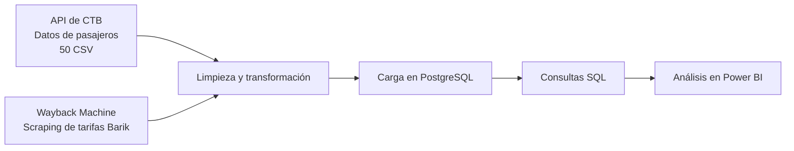

# Proyecto end-to-end de transporte en Bizkaia

### Resumen

### Origen - Destino

### Análisis

Proyecto de extracción, transformación y carga de datos de transporte de Bizkaia. Los datos se almacenan en PostgreSQL y se analizan con Power BI.

## Flujo del proyecto

1. **Extracción de pasajeros:** obtiene datos de la API de CTB.
2. **Extracción de tarifas:** obtiene mediante web scraping páginas históricas de tarifas Barik archivadas en [Internet Archive Wayback Machine](https://web.archive.org/).
3. **Limpieza:** transforma los datos para prepararlos para la carga.
4. **Carga:** almacena pasajeros y tarifas en PostgreSQL.
5. **Análisis:** consulta los datos con SQL y los presenta en Power BI.

El proceso ETL se organiza en `src/`: `extraccion.py`, `limpieza.py`, `carga.py` y `orquestador.py`.

## Fuentes de datos

- **Pasajeros:** API de CTB, configurada mediante la variable `URL`.
- **Tarifas Barik:** páginas históricas de CTB recuperadas desde Wayback Machine.

La disponibilidad de las páginas archivadas y el uso de los datos dependen de las condiciones de las fuentes originales y de Internet Archive.

## Tecnologías

- Python 3.14
- pandas
- requests
- PostgreSQL y psycopg
- Power BI

## Estructura

- `src/`: módulos del proceso ETL.
- `tests/`: pruebas automatizadas.
- `sql/schema.sql`: crea las tablas de pasajeros y tarifas.
- `sql/Analisis.sql`: consultas para explorar y comprobar los datos cargados.
- `sql/PBI_Query.sql`: consulta que combina viajes y tarifas y calcula el precio del billete.
- `powerbi/`: informe y modelo semántico de Power BI.
- `PBI.html`: página que incrusta un informe publicado.
- `requirements.txt`: dependencias de Python.
- `.env.example`: plantilla de configuración.

## Requisitos

- Python 3.14
- Una instancia de PostgreSQL accesible
- Acceso a la API de CTB
- Power BI para abrir o editar el informe

## Instalación

En PowerShell, desde la carpeta raíz del proyecto:

1. Crea y activa un entorno virtual:

   `py -3.14 -m venv .venv`

   `.\.venv\Scripts\Activate.ps1`

2. Instala las dependencias:

   `python -m pip install -r requirements.txt`

## Configuración

Crea un archivo `.env` a partir de `.env.example` y completa la URL de la API y los datos de conexión a PostgreSQL:

| Variable | Descripción |
|---|---|
| `URL` | URL de la API de CTB |
| `USERNAME_DB` | Usuario de PostgreSQL |
| `PASSWORD_DB` | Contraseña de PostgreSQL |
| `HOST_DB` | Servidor de PostgreSQL |
| `PORT_DB` | Puerto de PostgreSQL |
| `NAME_DB` | Nombre de la base de datos |
| `NAME_DB_TABLE_PASAJEROS` | Tabla de pasajeros |
| `NAME_DB_TABLE_TARIFAS` | Tabla de tarifas |

## Base de datos y consultas SQL

Conéctate a la base de datos configurada y ejecuta los archivos desde un cliente compatible con PostgreSQL, como pgAdmin o `psql`.

1. Ejecuta `sql/schema.sql` para crear las tablas `trans_viajes_bizkaia` y `tarifas_viajes` si todavía no existen.
2. Ejecuta el proceso ETL para cargar los datos.
3. Usa `sql/Analisis.sql` para consultar las tablas, revisar el rango de fechas y contar los registros.
4. Usa `sql/PBI_Query.sql` para obtener los viajes asociados a tarifas. La consulta une ambas tablas por año y modo de transporte, y calcula `precio_billete` según la zona más alta entre entrada y salida. Esta consulta es utilizada por Power BI para cargar el modelo semántico.

`Analisis.sql` y `PBI_Query.sql` son consultas de análisis; no crean tablas ni cargan datos.

## Ejecución del proceso ETL

Desde la raíz del proyecto:

`python .\src\orquestador.py`

## Pruebas

Ejecuta las pruebas automatizadas desde la raíz:

`python -m pytest -q`

## Dashboard

El proyecto de Power BI está en `powerbi/`. `PBI.html` incrusta un informe publicado; para visualizarlo se requiere conexión a Internet y permisos de acceso al informe.

## Seguridad y uso de datos

- No incluyas credenciales ni datos sensibles en el repositorio.
- Comprueba las condiciones de uso de la API y de las páginas archivadas antes de redistribuir datos.
- No subas el entorno virtual (`env/` o `.venv/`) al repositorio.
